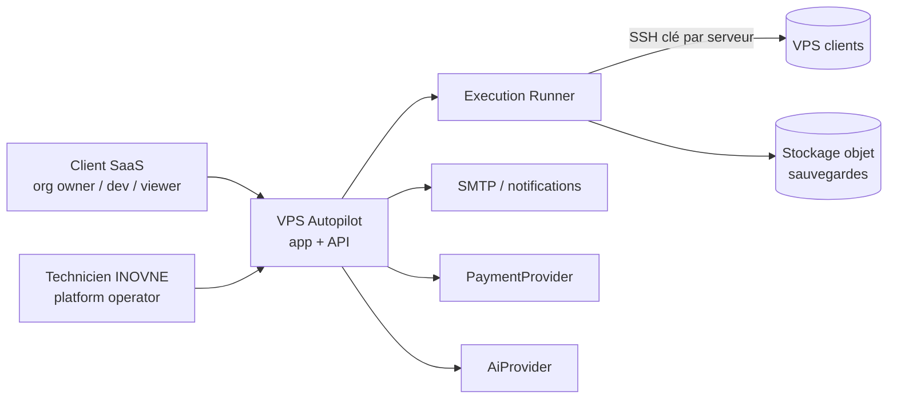

# Audit de l'existant et trajectoire SaaS + Managed — VPS Autopilot

> Statut : **HISTORIQUE — diagnostic pré-SaaS du 2026-11-07**.  
> **Ne plus suivre les phases 0–8 de ce document telles quelles.** Le profil `saas` (ADR-047→057), PostgreSQL/RLS, opérations, runner, IA, billing manuel, managed et Angular sont **livrés en lab** (voir `current_state.md` et le rapport d’audit du 2026-11-08).  
> **Plan d’exécution actuel (révisé)** : A stabiliser `platform` → B parité moteur SaaS (deploy livré en fondations) → C preuve bout-en-bout → D bascule prod (autorisation) → E modularisation Maven → F produit commercial → G extensions.  
> Date originale : 2026-11-07. Conservé pour traçabilité des constats S1–S10 (largement colmatés depuis).

---

## 0. Synthèse en dix lignes

1. **Le moteur d'exécution est l'actif principal** : il est solide, testé (222 tests verts) et éprouvé en production (ARC). On le garde.
2. **La couche « SaaS » (V9 / 2.0.0) n'est qu'une amorce** : il y a des comptes et un RBAC global, mais **aucune notion d'organisation**. Toutes les données sont dans des **fichiers JSON globaux**. L'isolation repose sur un filtre HTTP qui associe des préfixes d'URL à des permissions, et **ce filtre a des trous vérifiés** (§4.2).
3. **L'instance publique `autopilot.inovne.com` tient elle-même les clés SSH** des serveurs gérés. Une faille web y donne donc accès à toute la flotte. C'est le **risque n°1** (§11).
4. **L'approbation se résume aujourd'hui à un booléen `confirm=true`** envoyé par le client : elle n'est liée à aucun plan, n'expire pas et n'a pas d'approbateur distinct.
5. **Aucune IA, aucune base de données, aucune facturation, aucune internationalisation, pas d'Angular** : la console est en JavaScript vanilla, un fichier de 4 400 lignes.
6. **Stack cible Angular + Spring Boot + PostgreSQL** : compatible. Le backend est déjà en Spring Boot 3.3 / Java 21, donc rien à jeter de ce côté. Seul le front change de technologie, et la migration se fait progressivement, en remplaçant la console écran par écran.
7. **Recommandation** : un monolithe modulaire Maven en trois ensembles (`engine`, `control-plane`, `managed`). Le moteur est extrait **sans réécriture**, en plaçant des interfaces (ports) devant les stores JSON actuels.
8. **Ordre proposé** :
   - Phase 0 : stabiliser et corriger les failles.
   - Phase 1 : découper en modules.
   - Phase 2 : PostgreSQL et organisations.
   - Phase 3 : opérations et approbations.
   - Phase 4 : coffre de secrets et runner séparé.
   - Phase 5 : API et Angular.
   - Ensuite : services managés, facturation, IA.
9. **Effort estimé pour un développeur** : environ 9 à 12 mois jusqu'à un SaaS vendable (phases 0 à 6), facturation réelle et IA non comprises.
10. **Prérequis commercial non technique** : `BIZ-02`, c'est-à-dire un parcours complet sur un VPS vierge, n'a **jamais** été joué d'affilée. Un SaaS « self-service » sans ce test est risqué.

---

## 1. État réel du projet

| Élément | Constat vérifié |
|---|---|
| Langage / framework | Java 21, Spring Boot 3.3.6, un module Maven, `spring-boot-starter-web`, `validation`, `spring-security-crypto` (BCrypt seul, **pas Spring Security**), SSHJ, spring-dotenv |
| Taille | ~110 classes Java (~17 k lignes), 14 rôles bash (~2 600 lignes), console statique `console.js` 4 408 lignes + `index.html` 1 086 + `admin.html` 650 |
| Persistance | **Fichiers JSON / JSONL** sous `state/` (écriture atomique tmp+move pour `state/platform/`) — aucune base de données |
| Tests | `mvn test` le 2026-11-07 : **222 exécutés, 0 échec, 3 ignorés** (tests lab SSH réels). JUnit 5 + MockMvc ; pas de Mockito massif, **pas de Testcontainers** |
| Profils | défaut (console mono-poste `127.0.0.1`, sans auth), `cargo` (public, santé seule), `platform` (multi-comptes, public) |
| Déploiement | jar zip (`scripts/release.ps1`) ; image Docker profil `platform` sur le lab `57.128.186.38` derrière Traefik / Let's Encrypt |
| Git | dernier commit 2026-10-15 ; **tout le V9 est non commité** ; `dist/`, `node_modules/`, `package.json` (npm init accidentel), `state-platform-smoke/` non ignorés |
| Production réelle | ARC (`213.156.134.92`) déployé et sauvegardé par l'agent ; DTSI (`154.0.30.233`) en lecture seule ; lab public Inovne |

---

## 2. Fonctionnalités et maturité (matrice directive §2)

Légende qualité : **S** satisfaisante, **I** insuffisante pour un SaaS, **–** sans objet.

| Fonctionnalité | État réel (vérifié dans le code) | Qualité | Action |
|---|---|---|---|
| Discovery SSH read-only (script stdin, parseur, snapshot) | Fonctionnelle, testée (`DiscoveryParserTest`, fixtures), multi-familles Linux | S | **Conserver** (cœur engine) |
| Audit noté A–E + HTML (`AuditRules`) | Fonctionnelle, domaine pur, testée | S | Conserver ; i18n plus tard |
| Garde de risque READ / CHANGE / DESTRUCTIVE (`ActionGuard`) | Fonctionnelle : liste blanche de 17 actions + `confirmed` booléen | I | **Améliorer** : opération + plan haché + approbation (ADR-050) |
| Cibles protégées (`ForbiddenTargetGuard`) | Fonctionnelle (bloqué / lecture seule, fichier local) | S | Conserver ; devient une politique par serveur en base |
| Rôles d'installation (security, docker, traefik, mariadb, redis, deploy) | Fonctionnels, idempotents, éprouvés lab + ARC | S | **Conserver tels quels** (scripts versionnés) |
| Deploy app 1:1 et plateforme N services, modèles Dockerfile | Fonctionnels, en prod ARC ; redeploy par service (V7-07) | S | Conserver |
| Jobs détachés `systemd-run` (`RemoteJobRunner`) | Fonctionnel, testé, éprouvé (6 min 20) | S | Conserver |
| Suivi de jobs côté agent (`LongJobTracker`) | En mémoire JVM : perdu au redémarrage | I | Améliorer : jobs persistés (table `operation_execution`) |
| Verrou de déploiement (`DeployLock`) | `ConcurrentHashMap` par hôte, mono-instance | I | Améliorer : verrou en base (unique / advisory lock) |
| Sauvegardes chiffrées, vérification, exercice mensuel, restauration plateforme | Fonctionnelles, éprouvées ARC (46/46 tables, 39/39 fichiers) | S | Conserver ; stockage sur le poste = **I** pour SaaS (BIZ-09) |
| Console SQL avec politique (`SqlConsolePolicy`) | Fonctionnelle, testée, sauvegarde avant écriture | S | Conserver |
| Secrets d'exécution posés sur le VPS (ADR-043) | Fonctionnels ; la valeur ne transite pas par le poste | S | Conserver |
| Variables d'env des plateformes (`platforms-intent.json`) | **Valeurs en clair sur disque** (masquées seulement dans l'API) | I | Améliorer : coffre (ADR-051) |
| Clé SSH de l'agent | **Une seule clé** pour tous les serveurs, chemin de fichier ; sur l'instance publique en profil `platform` | I | **Remplacer** : identifiant par serveur, chiffré, runner séparé |
| Alertes e-mail envoyées par le VPS | Fonctionnelles (lab), non posées sur ARC | S | Conserver |
| Journal des actions (`state/journal/*.jsonl`) | Fonctionnel ; opérateur = **compte Windows**, pas le compte plateforme (PLAT-07) ; aucune protection d'intégrité ; aucune rétention | I | Améliorer : `audit_event` append-only chaîné (ADR-053) |
| Auth plateforme (BCrypt, sessions, lien magique, reset) | Fonctionnelle, testée ; sessions dans un fichier JSON ; **pas de limitation de tentatives** ; défauts « fail-open » (§4.2) | I | Améliorer puis migrer vers Spring Security |
| RBAC (13 permissions, rôles éditables, grants serveur) | Partiel : **global, sans organisation** ; contrôle par préfixe d'URL avec trous | I | **Remplacer progressivement** par contrôle au niveau service + organisation |
| Multi-tenancy | **Absente** | – | Planifier (ADR-049) |
| Abonnements / facturation | Absents (grille FCFA dans `business.md` seulement) | – | Planifier (fondations seulement) |
| Services managés | Absents dans le code ; documents commerciaux (mandat, retrait des accès) | – | Planifier (ADR-052) |
| IA | **Absente** (aucune référence fournisseur dans le code) | – | Planifier en dernier (ADR-054) |
| i18n | Absente : textes français codés en dur (Java, bash, HTML) | – | Planifier |
| API publique / tokens / OpenAPI | Absents ; API `/api/v1` interne, non documentée en OpenAPI | – | Planifier |
| Observabilité | Logs texte ; pas d'Actuator, pas de correlation ID, pas de `@ControllerAdvice` | I | Améliorer en phase 1 |
| Ansible | Spécifié, jamais fait ; bash idempotent accepté de fait | – | **Abandonner formellement** (ADR à acter) : le bash versionné fonctionne |
| Parcours guidé sur VPS vierge | Jamais testé d'affilée (BIZ-02) | I | **Prérequis commercial** |

---

## 3. Architecture actuelle

```
Navigateur (console.js vanilla, 4 400 l.)
        │  HTTP /api/v1/*  (profil platform : cookie session + PlatformAuthFilter + PlatformRbacFilter)
        ▼
Spring Boot monolithe (1 module)
  api/         17 contrôleurs  ──►  logique métier mêlée (stores, SSH, journal)
  stack/       43 classes : plans, rôles, deploy, backups, SQL, secrets, intents (JSON)
  ssh/         SshConnector (SSHJ), RemoteJobRunner, DeployLock (mémoire)
  discovery/   script + parseur        audit/  règles pures
  journal/     JSONL par hôte          platform/  comptes, rôles, grants, sessions (JSON)
  state/       StateStore, KnownServerStore (JSON)
        │ SSH (clé unique de l'instance) + scripts bash sur stdin
        ▼
VPS clients (rôles bash idempotents, systemd-run, Docker, Traefik, MariaDB)
```

**Bon :**
- **Le domaine est souvent pur et testable** : `AuditRules`, `SqlConsolePolicy`, `PlatformCompose`, `InstallPlanBuilder`, `StackPolicy`, `DiscoveryParser`.
- **Les scripts serveur sont versionnés et passent sur stdin**, sans shell libre.
- **L'idempotence est réelle.**
- **La documentation est très riche** et distingue ce qui est spécifié de ce qui est implémenté.

**Dette :**
- **Package `stack/` fourre-tout** : il mélange les intents, l'orchestration SSH, les sauvegardes, le SQL et les secrets.
- **Contrôleurs qui orchestrent eux-mêmes** : `PlatformController` fait 422 lignes et lance des jobs et des e-mails.
- **Pas de ports** : les services appellent directement `SshConnector` et les stores fichiers.
- **Autorisation par URL** (`RoutePermissions`) et non au niveau des cas d'usage.

---

## 4. Problèmes architecturaux identifiés

### 4.1 Structurels

| # | Problème | Conséquence |
|---|---|---|
| P1 | **Stockage par fichiers JSON globaux** : `apps-intent.json`, `platforms-intent.json`, `stack-intent.json`, `known-servers.json`, `state/<host>.json` | Rien n'appartient à personne ; pas de transactions ni d'accès concurrent multi-instance ; pas de migration de schéma |
| P2 | **Identité serveur = chaîne `host`** (parfois `host:port:user`) | Deux organisations qui gèrent la même IP (cas réel d'infogérance) entrent en collision |
| P3 | **Cockpit et exécuteur dans le même processus**, avec la clé SSH | Le blast radius d'une faille web couvre tous les serveurs |
| P4 | **État d'exécution en mémoire** (`LongJobTracker`, `DeployLock`) | Un redémarrage perd le suivi ; impossible de passer à plusieurs instances |
| P5 | **Approbation = booléen client** | Aucune preuve de « qui a approuvé quoi » ; un plan modifié après affichage reste exécutable |
| P6 | **Front monolithique vanilla** | Coût d'évolution croissant ; pas d'i18n ni de tests front |
| P7 | **Textes français dans le Java et le bash** (messages d'erreur, rapports, e-mails) | L'i18n demandera une extraction systématique |

### 4.2 Sécurité : constats vérifiés dans le code (profil `platform`)

| # | Constat | Gravité | Preuve |
|---|---|---|---|
| S1 | `GET /api/v1/state` renvoie le **dernier snapshot, tous serveurs confondus**, à tout compte qui a `server.read`. Le grant n'est pas vérifié | Élevée | `DiscoverController.latest()` ; `RoutePermissions` : règle par défaut non scopée |
| S2 | `GET /api/v1/journal` sans `host` : contrôle de permission seulement. La réponse inclut `journals: store.keys()`, soit **la liste de tous les serveurs journalisés** | Moyenne | `JournalController.list` + `PlatformRbacFilter` (repli quand `host` est vide) |
| S3 | `GET/PUT/DELETE /api/v1/platforms` et `/apps` : les intentions sont **globales et non scopées**. Un compte `server.change.deploy` peut modifier le `gitUrl` d'une plateforme d'un autre ; le propriétaire déploie ensuite du code tiers | **Élevée** | `RoutePermissions` : `serverScoped=false` pour PUT/DELETE sans `status/sql` |
| S4 | Règle générale : une route marquée `serverScoped` **dont la requête ne porte pas `host`** retombe sur la seule permission (`PlatformRbacFilter`, branche `t.host == null`) | Moyenne | `GET /platforms/jobs/{jobId}` notamment (jobId aléatoire, ce qui atténue) |
| S5 | **Défauts « fail-open »** : `mail-dev-capture` vaut `true` par défaut, y compris dans `application-platform.yml`. Avec cette valeur, le lien magique et le lien de reset sont **renvoyés dans la réponse HTTP à n'importe qui**, et l'e-mail fondateur est public | **Critique si mal configuré** | `AuthService.requestMagicLink`. **L'image du lab force `PLATFORM_MAIL_DEV_CAPTURE=false`** (`Dockerfile` l. 23), donc le lab est a priori protégé ; à confirmer sur le conteneur en service (`app.env` peut surcharger) |
| S6 | Mot de passe par défaut **codé en dur et documenté** ; « remettre le mot de passe usine » disponible via un lien de reset | Moyenne | `AuthService.completePasswordResetToDefault`, `application*.yml` |
| S7 | **Aucune limitation de tentatives** sur `/auth/login`, `/auth/request`, `/auth/forgot-password` | Moyenne | Aucun rate limiting dans le code |
| S8 | Sessions et jetons dans `state/platform/*.json`, lus et réécrits entièrement à chaque requête (`purgeExpired`) | Faible en sécurité, **élevée en performance** | `SessionStore.findValid` |
| S9 | Clé SSH unique, fichier non chiffré côté exécuteur ; `backup.key` en clair dans `state/` | Élevée pour un SaaS | `DevopsProperties.ssh.privateKeyPath`, `state/backup.key` |
| S10 | Donnée d'exploitation suspecte : la variable `JWT_SECRET` du service `prism/api` contient la chaîne `SPRING_PROFILES_ACTIVE=staging`, qui ressemble à un copier-coller erroné | À vérifier côté PRISM | `state/platforms-intent.json` (DTSI, déployé hors agent) |

Ces constats **ne remettent pas en cause** la console locale (profil défaut, `127.0.0.1`, mono-opérateur). Ils concernent l'exposition publique du profil `platform`.

---

## 5. Écarts par rapport à la vision SaaS + Managed

| Domaine cible | Existant | Écart | Importance | Risque | Effort | Dépend de | Priorité |
|---|---|---|---|---|---|---|---|
| Sécurité de l'instance publique | Filtres URL, défauts fail-open, clé SSH sur l'instance | Corrections S1–S9 | Critique | Élevé | S | — | **P0** |
| Séparation engine / control plane | Monolithe sans ports | Modules + interfaces | Fondation | Faible si fait sans changer le comportement | M | P0 | **P1** |
| Persistance | JSON | PostgreSQL + Flyway + import des JSON | Fondation | Moyen (migration de données) | L | P1 | **P1** |
| Multi-tenancy | Absente | Organization, Membership, scoping, RLS | Critique | Élevé (fuite inter-clients) | L | Persistance | **P1** |
| Opérations / approbations | Booléen | Operation, Approval (hash, TTL), Execution (idempotence) | Critique | Moyen | L | Persistance | **P2** |
| Credentials | Clé unique en fichier | ServerCredential chiffré (enveloppe), rotation, révocation | Critique | Élevé | L | Persistance | **P2** |
| Runner séparé | Même JVM | Runner sortant (pull), sans port entrant | Important | Moyen | L | Opérations, credentials | **P3** |
| Audit trail | JSONL par hôte | `audit_event` append-only, chaîné, rétention | Important | Faible | M | Persistance | **P2** |
| API versionnée + OpenAPI + tokens | `/api/v1` interne | Séparation public / client / admin / interne, scopes | Important | Faible | M | Multi-tenancy | **P3** |
| Front Angular + i18n EN/FR | Vanilla FR | Nouvelle app, remplacement progressif écran par écran | Important | Moyen (parité fonctionnelle) | XL | API | **P3** |
| Managed Operations | Docs commerciales | Contrats, accès support temporaire, interventions | Important pour INOVNE | Moyen | M | Opérations, multi-tenancy | **P4** |
| Abonnements / quotas | Absents | Plan, Subscription, quotas, PaymentProvider (interface) | Commercial | Faible | M | Multi-tenancy | **P4** |
| Paiement réel | Absent | Adaptateur(s), webhooks idempotents | Différé | Moyen | M | Validation commerciale | **P5** |
| IA | Absente | Ports AI, schémas stricts, recommandations | Différenciant | Moyen (sécurité) | L | Opérations | **P5** |
| Stockage de sauvegardes hors poste | Poste opérateur | StorageProvider (S3 compatible) | Important pour SaaS | Moyen | M | Credentials | **P3** |
| Observabilité | Logs texte | Actuator, correlation ID, logs JSON, `@ControllerAdvice` | Important | Faible | S | — | **P1** |

---

## 6. Architecture cible recommandée

### 6.1 Principe (ADR-047 proposé)

**Monolithe modulaire Maven** en architecture hexagonale pragmatique. Pas de microservices.

Le runner d'exécution est **le seul composant** qui pourra tourner à part (phase 4), pour une raison de **sécurité** et non de mode : séparer les clés SSH de l'interface exposée.

### 6.2 C4 — niveau 1 (contexte)



### 6.3 C4 — niveau 2 (conteneurs)

| Conteneur | Techno | Rôle | Exposé |
|---|---|---|---|
| `web` | Angular (SPA statique) | UI SaaS + back-office INOVNE | `app.` |
| `api` (control plane) | Spring Boot | Comptes, orgs, serveurs, opérations, approbations, audit, facturation, managed | `api.` |
| `runner` (execution engine) | Spring Boot (même code `engine`) | Tire les exécutions approuvées, SSH, scripts, rend les preuves | **Aucun port entrant** (HTTPS sortant vers l'API) |
| `postgres` | PostgreSQL 16 | Données control plane (+ RLS) | Privé |
| Console locale | jar actuel (profil défaut) | Édition mono-poste, inchangée | `127.0.0.1` |

En phases 1 à 3, `api` et `runner` sont **le même processus** avec un adaptateur in-process. Le découpage physique arrive en phase 4, sans changer le code métier.

### 6.4 Modules (C4 niveau 3)

```
engine-domain      ← pur Java : snapshots, plans, OperationType, RiskLevel, politiques (SqlConsolePolicy, AuditRules, StackPolicy…)
engine-core        ← cas d'usage : discover, plan, install, deploy, backup, restore, sql, secrets
                     ports sortants : RemoteShell, CredentialProvider, IntentRepository, SnapshotRepository, JobStore, BackupStorage
engine-adapters    ← SSHJ, RemoteJobRunner, rôles bash (resources), stores JSON (édition locale)
control-plane      ← identity, organization, server, operation, approval, audit, notification, api-token
managed            ← contrats, accès support, interventions, rapports
billing            ← plan, subscription, quota, invoice, PaymentProvider (port)
ai                 ← AiProvider, prompts, context builder (sans secrets), recommandations
app-local          ← boot console locale (profil défaut) = engine + adaptateurs JSON
app-saas           ← boot SaaS = control-plane + managed + billing + ai + engine (in-process puis distant)
runner             ← boot runner = engine + client vers l'API
web/               ← Angular
```

**Règles de dépendance**, vérifiées par ArchUnit en CI :
- `engine-*` ne connaît **ni** `control-plane`, ni `billing`, ni `ai`.
- `billing` et `managed` ne parlent à `engine` qu'à travers `control-plane.operation`.
- Aucune classe de `*-domain` n'importe Spring.

Ce choix répond à une contrainte réelle : **la console locale actuelle doit continuer de marcher**. Les ports permettent de garder les stores JSON pour l'édition locale tandis que le SaaS utilise PostgreSQL. C'est la justification concrète de l'hexagonal ici.

### 6.5 Flux d'une opération CHANGE (cible)

```mermaid
sequenceDiagram
  participant U as Utilisateur (org)
  participant API as Control plane
  participant A as Approbateur
  participant R as Runner
  participant V as VPS
  U->>API: POST /operations (serveur, type, paramètres, motif)
  API->>API: autorisation (org + permission) ; plan déterministe (engine) ; hash du plan
  API-->>U: plan + risque + hash
  A->>API: POST /operations/{id}/approvals (hash vu, TTL)
  API->>API: hash identique ? non expiré ? approbateur ≠ initiateur si politique ; verrou serveur
  API->>R: exécution (id, clé d'idempotence)
  R->>V: SSH (credential du serveur, script versionné)
  R-->>API: résultat + preuve (code, sortie tronquée, empreinte)
  API->>R: vérification post-exécution (discovery READ)
  API->>API: audit_event chaîné ; notification
```

### 6.6 Modèle de sécurité

| Couche | Mesure |
|---|---|
| Authentification | Spring Security ; sessions en base (ou JWT court + refresh), MFA TOTP en phase 5, rate limiting (bucket par IP + compte) |
| Autorisation | Au niveau **cas d'usage** (`@PreAuthorize` + `OrgAccessPolicy`), plus le filtre URL comme simple filet ; principe « pas de permission = refus » |
| Isolation | `organization_id` NOT NULL sur toute table métier ; repositories qui exigent un `OrgScope` ; **PostgreSQL RLS** en défense en profondeur sur `server`, `server_credential`, `operation*`, `audit_event` (`SET LOCAL app.org_id` par transaction) |
| IDOR | Identifiants UUID ; toute lecture par id passe par `findByIdAndOrg` ; tests d'isolation systématiques |
| Secrets | Chiffrement par enveloppe : DEK par org, KEK hors base (fichier monté, puis KMS / Vault) ; jamais exposés en API, jamais envoyés à l'IA |
| Exécution | Liste blanche d'`OperationType` (reprend les 17 actions actuelles) ; DESTRUCTIVE refusé tant qu'une politique dédiée n'existe pas |
| Support INOVNE | `SupportAccessGrant` : demandé, accordé par l'org, borné dans le temps, révocable, chaque usage audité |
| Audit | Append-only : pas d'UPDATE/DELETE pour le rôle applicatif, hash chaîné par org, export |

---

## 7. Proposition de migration incrémentale

Principe : **remplacer progressivement l'existant (strangler), sans casser la console locale ni ARC**. Chaque phase se termine sur `mvn verify` vert et des tests d'isolation verts, avec la doc (`changelog`, `current_state`, Aide) à jour.

| Donnée actuelle | Cible | Migration |
|---|---|---|
| `state/platform/accounts.json`, `roles.json` | `app_user`, `platform_role` + `membership` | Importeur idempotent ; SUPER_ADMIN devient PLATFORM_ADMIN ; les autres comptes deviennent membres de l'org « INOVNE Lab » |
| `server-grants.json` | `server` (org) + `membership` / permissions | Chaque `host:port:user` donne un `server` dans l'org du grant |
| `known-servers.json`, `state/<host>.json` | `server`, `server_snapshot` | Import du dernier snapshot |
| `apps-intent.json`, `platforms-intent.json`, `stack-intent.json` | `deployment_spec` (org, serveur) | Import ; les valeurs d'env sensibles partent dans `secret` chiffré |
| `journal/*.jsonl` | `audit_event` (statut `imported`) | Import en lecture seule, sans chaînage rétroactif |
| Clé SSH unique, `git-deploy-keys/`, `backup.key` | `server_credential`, `git_credential`, `backup_key` chiffrés | Import manuel guidé (pas automatique), puis rotation |
| `sessions.json`, `magic-tokens.json` | Tables dédiées | Pas de migration : reconnexion forcée |

**Retour arrière :**
- Chaque import est **non destructif** : les JSON restent en place.
- L'édition locale continue de lire les JSON.
- En SaaS, l'ancien jar 2.0.0 reste déployable tant que la phase 2 n'est pas validée en lab.
- Les migrations Flyway sont réversibles par restauration du dump pris avant la migration.

---

## 8. Arborescence cible

```
devops-agent/                      (dépôt conservé ; renommage éventuel plus tard)
  pom.xml                          parent (modules ci-dessous)
  engine/
    engine-domain/                 src/main/java/com/inovne/autopilot/engine/domain/...
    engine-core/                   .../engine/application/{discover,install,deploy,backup,sql,secret}/
    engine-adapters/               .../engine/adapters/{ssh,jobs,roles,jsonstore}/
                                   src/main/resources/roles/**  (scripts bash actuels, inchangés)
  control-plane/
    identity/  organization/  server/  operation/  audit/  notification/  apitoken/
      (chacun : domain/ application/ adapters/{web,persistence}/)
  managed/                         contract/ supportaccess/ intervention/ report/
  billing/                         plan/ subscription/ quota/ invoice/ payment/(port)
  ai/                              provider/(port) prompt/ context/ recommendation/
  apps/
    app-local/                     console actuelle (static/ conservé tant qu'Angular n'a pas la parité)
    app-saas/                      src/main/resources/db/migration/V1__...sql (Flyway)
    runner/
  web/                             Angular (projects/app, projects/backoffice, libs/ui, libs/i18n)
  .docs/  .cursor/  scripts/  infrastructure/
```

Le renommage du package `com.nebdev.devopsagent` en `com.inovne.autopilot` se fait **module par module**, lors de l'extraction : jamais un renommage global d'un seul coup.

---

## 9. Modèle de données cible (PostgreSQL)

Toutes les tables métier portent `id uuid`, `organization_id uuid NOT NULL` (sauf tables plateforme), `created_at`, `updated_at`, `version` (verrouillage optimiste).

| Table | Champs clés | Notes |
|---|---|---|
| `app_user` | email unique, password_hash, locale, time_zone, mfa_secret_enc, status | Un utilisateur, plusieurs orgs |
| `organization` | name, slug, default_locale, default_time_zone, billing_currency, customer_type (`SAAS`, `SAAS_ASSISTED`, `MANAGED`) | Le type distingue SaaS et Managed |
| `membership` | user_id, organization_id, role_id, status | Unique (user, org) |
| `role` / `permission` / `role_permission` | scope `PLATFORM` ou `ORGANIZATION` | Rôles éditables ; codes permission stables (reprend les 13 actuels) |
| `platform_staff` | user_id, platform_role (`PLATFORM_ADMIN`, `PLATFORM_OPERATOR`) | **Distinct** des memberships clients |
| `server` | organization_id, name, host, ssh_port, ssh_user, os_family, os_version, connection_state, last_checked_at, engine_version, capabilities jsonb, maintenance_state, protection (`NONE`, `READ_ONLY`, `BLOCKED`) | Unique (org, host, port, user) : deux orgs peuvent avoir la même IP |
| `server_credential` | server_id, kind (`SSH_KEY`), public_key, private_key_enc, dek_ref, fingerprint, created_at, rotated_at, revoked_at | Séparée des métadonnées ; jamais exposée |
| `server_snapshot` | server_id, taken_at, payload jsonb, discovery_version | Rétention : N derniers + 1 par mois |
| `deployment_spec` | server_id, kind (`APP`, `PLATFORM`), spec jsonb, spec_version | Remplace les intents JSON |
| `secret` | organization_id, owner_ref, name, value_enc | Valeurs d'env sensibles, clés Git, clé de sauvegarde |
| `operation` | organization_id, server_id, type, risk_level, initiator_id, reason, parameters jsonb, plan jsonb, plan_hash, status, origin (`USER`, `SCHEDULE`, `AI_SUGGESTION`, `MANAGED`) | Statuts : DRAFT → PROPOSED → APPROVED → RUNNING → SUCCEEDED / FAILED / CANCELLED / EXPIRED |
| `operation_approval` | operation_id, approver_id, plan_hash, approved_at, expires_at, decision | Invalide si `plan_hash` change |
| `operation_execution` | operation_id, idempotency_key unique, runner_id, started_at, ended_at, exit_code, output_excerpt, output_sha256, verification jsonb | Un seul RUNNING par serveur (index unique partiel) |
| `audit_event` | organization_id, actor_type, actor_id, action, target_ref, outcome, details jsonb, at, prev_hash, hash | Append-only (REVOKE UPDATE/DELETE) |
| `notification` | organization_id, channel, template_key, locale, payload, status, sent_at | Gabarits multilingues |
| `api_token` | organization_id, name, token_hash, scopes[], expires_at, revoked_at, last_used_at | Seul le hash est stocké |
| `managed_contract` | organization_id, service_level, scope jsonb, starts_at, ends_at, status | |
| `managed_contract_server` | contract_id, server_id | |
| `support_access_grant` | organization_id, staff_user_id, scope, granted_by, starts_at, expires_at, revoked_at | Seul moyen pour un opérateur INOVNE d'agir chez un client |
| `intervention` | organization_id, contract_id, server_id, requested_by, assigned_to, status, summary, operation_ids[] | Les interventions réutilisent `operation` |
| `plan` / `subscription` / `usage_quota` / `invoice` / `payment_transaction` | currency (ISO 4217, dont XOF), amount_minor, provider, provider_ref unique, status | `provider_ref` unique pour l'idempotence des webhooks |
| `ai_interaction` | organization_id, provider, model, prompt_key, input_digest, output jsonb, schema_valid, operation_id | Aucune donnée secrète en entrée |

**Note sur `server` :** l'identité actuelle `host` (P2) devient `server.id`. Les grants actuels disparaissent : le serveur appartient à l'org, et les membres accèdent selon leur rôle.

---

## 10. Plan d'exécution priorisé

| Phase | Contenu | Livrable vérifiable | Complexité | Estimation (1 dev) |
|---|---|---|---|---|
| **0. Stabiliser et colmater** | <ul><li>Commit et tag 2.0.0 après `.gitignore` : `dist/`, `node_modules/`, `package.json`, `state-platform-smoke/`</li><li>Corriger S1–S4 (scoper `/state`, `/journal`, les intents ; refuser par défaut une route scopée sans `host`)</li><li>S5–S7 : `mail-dev-capture=false` et `cookie-secure=true` par défaut en profil `platform`, refus de démarrer avec le mot de passe par défaut, suppression du « reset usine » en `platform`, rate limiting sur l'auth</li><li>`@ControllerAdvice`, Actuator, correlation ID</li><li>Vérifier S10 avec le porteur</li><li>BIZ-02 sur un VPS jetable</li></ul> | Tests de non-régression d'accès (un compte A ne voit pas B), 222+ tests verts | S | 1–2 sem. |
| **1. Modulariser sans changer le comportement** | <ul><li>Maven multi-module `engine-*` / `app-local` / `app-saas`</li><li>Ports devant SSH et les stores JSON</li><li>Contrôleurs amincis</li><li>ArchUnit en CI</li><li>Extraction des messages vers des bundles (FR d'abord)</li></ul> | Même jar local fonctionnel, mêmes tests verts, règles ArchUnit actives | M | 3–5 sem. |
| **2. PostgreSQL + organisations** | <ul><li>Flyway, entités identity / organization / membership / server / deployment_spec / snapshot</li><li>Scoping obligatoire, RLS sur les tables sensibles</li><li>Importeur des JSON</li><li>Testcontainers et suite d'isolation multi-tenant</li></ul> | Lab SaaS sur Postgres ; tests « org A ↛ org B » sur chaque endpoint | L | 5–7 sem. |
| **3. Opérations et approbations** | <ul><li>`operation` / `approval` / `execution`</li><li>Hash du plan, TTL, idempotence, verrou serveur en base</li><li>Jobs persistés (fin de `LongJobTracker` en mémoire)</li><li>`audit_event` chaîné, rétention</li></ul> | Tests : plan modifié = approbation invalide ; double POST = une seule exécution ; deux deploys concurrents = un refus | L | 4–6 sem. |
| **4. Credentials et runner** | <ul><li>Coffre par enveloppe, clé SSH par serveur (génération, pose, rotation, révocation)</li><li>Runner séparé en pull sortant, sans clé dans `api`</li><li>`BackupStorage` S3 compatible</li></ul> | Instance publique sans aucune clé SSH ; rotation testée sur le lab | L | 4–6 sem. |
| **5. API et front** | <ul><li>OpenAPI, API client / admin / interne séparées, API tokens à scopes</li><li>Angular (shell, auth, orgs, serveurs, opérations, approbations, audit) en EN/FR</li><li>MFA</li><li>Remplacement progressif des écrans de la console vanilla</li></ul> | Parcours SaaS complet en Angular EN/FR ; e2e Playwright | XL | 8–12 sem. |
| **6. Managed (fondations)** | <ul><li>`platform_staff`, `support_access_grant`, contrats, interventions liées aux opérations, rapport d'intervention (réutilise audit + journal export)</li></ul> | Un technicien n'agit chez un client qu'avec un accès accordé, expirant et audité | M | 3–4 sem. |
| **7. Abonnements (fondations)** | <ul><li>Plan, abonnement, quotas (nombre de serveurs), essai</li><li>Port `PaymentProvider` + adaptateur « manuel / facture » ; webhooks idempotents prêts</li></ul> | Quota appliqué (refus du serveur n+1), tests d'idempotence | M | 2–3 sem. |
| **8. IA (assistance)** | <ul><li>Port `AiProvider` (un adaptateur), prompts versionnés, context builder qui filtre les secrets</li><li>Sortie JSON validée par schéma vers une `operation` DRAFT seulement</li></ul> | L'IA ne peut produire qu'un DRAFT d'un type existant ; tests d'injection de prompt | L | 3–5 sem. |
| 9. Paiement réel, multi-fournisseurs, flotte | Après validation commerciale | — | M–L | — |

**Total des phases 0 à 6 : environ 28 à 42 semaines** pour un développeur. Les phases 2 et 3 peuvent se chevaucher partiellement.

**Recommandation de séquencement commercial :**
- **Service managé d'abord** (ADR-039 reste valide). Le Managed n'exige que les phases 0 à 4 et 6 : INOVNE opère, avec le back-office existant amélioré.
- **Le SaaS self-service** (phases 5 et 7) arrive quand des clients managés auront validé le moteur.

---

## 11. Risques et mesures de sécurité

| Risque | Probabilité | Impact | Mesure |
|---|---|---|---|
| Compromission de l'instance publique, qui tient les clés SSH | Moyenne | **Critique** (toute la flotte) | Phase 0 (S1–S7) ; phase 4 (runner séparé, clés par serveur) ; d'ici là, limiter les serveurs assignés sur l'instance publique au strict lab |
| Fuite de données entre organisations | Moyenne sans tests | Critique | Scoping obligatoire + RLS + suite de tests d'isolation bloquante en CI |
| Opération rejouée ou modifiée après approbation | Faible | Élevé | Hash du plan, TTL, clé d'idempotence, verrou par serveur |
| Régression sur ARC pendant la refonte | Moyenne | Élevé | Console locale conservée ; aucune action sur ARC sans accord ; lab d'abord |
| Migration de données JSON vers Postgres incomplète | Moyenne | Moyen | Importeur idempotent et rejouable, JSON conservés, comparaison avant / après |
| Front Angular jamais à parité | Moyenne | Moyen | Remplacement écran par écran ; la console vanilla reste la référence jusqu'à parité |
| Sur-architecture | Moyenne | Moyen | Pas de module sans cas d'usage livré ; facturation et IA reportées |
| IA proposant une action dangereuse | Moyenne | Élevé | L'IA ne produit que des DRAFT d'`OperationType` en liste blanche ; secrets filtrés ; schéma strict |
| Responsabilité juridique (Managed) | — | Élevé | Mandat relu par un juriste (BIZ-07), accès support contractualisé et audité |
| Bus factor (un seul porteur) | Élevée | Élevé | La doc `.docs/` est un atout, à maintenir ; ADR systématiques |

---

## 12. Ce qu'on garde, ce qu'on transforme

| Garder tel quel (déplacement de package seulement) | Transformer |
|---|---|
| <ul><li>Rôles bash `roles/**`</li><li>`discovery.sh`, `DiscoveryParser`</li><li>`AuditRules`, `AuditHtmlRenderer`</li><li>`SqlConsolePolicy`, `StackPolicy`, `InstallPlanBuilder`</li><li>`PlatformCompose`, `PlatformSpec`, `PlatformServiceSpec`, modèles Dockerfile</li><li>`RemoteJobRunner` et scripts `job-*.sh`</li><li>`BackupArchive`, `BackupService` (logique)</li><li>`PlatformRestoreService`, `PlatformSecretService`</li><li>`SshConnector` (derrière un port)</li><li>`ForbiddenTargetGuard` (devient politique serveur)</li><li>`PasswordHashes` (BCrypt)</li><li>La suite de tests existante</li></ul> | <ul><li>Stores JSON : derrière des ports, conservés pour l'édition locale</li><li>`ActionGuard` (booléen) : modèle Operation / Approval</li><li>`LongJobTracker`, `DeployLock` : persistés</li><li>`JournalStore` : `audit_event`</li><li>`platform/*` (auth, RBAC, grants) : Spring Security + organisations</li><li>`RoutePermissions` : simple filet, l'autorisation passe dans les cas d'usage</li><li>Clé SSH unique : credentials par serveur</li><li>`console.js` : Angular, progressivement</li><li>Textes FR codés en dur : bundles i18n</li></ul> |

---

## 13. ADR proposés (à valider)

| ADR | Décision proposée |
|---|---|
| ADR-047 | Monolithe modulaire hexagonal (`engine` / `control-plane` / `managed` / `billing` / `ai`), règles ArchUnit ; pas de microservices |
| ADR-048 | PostgreSQL + Flyway pour le SaaS ; les stores JSON restent l'adaptateur de l'édition locale |
| ADR-049 | Multi-tenancy par `organization_id` + scoping obligatoire + RLS sur les tables sensibles ; identité serveur = UUID dans une org |
| ADR-050 | Opération CHANGE = plan déterministe haché, approbation liée au hash avec TTL, exécution idempotente, verrou serveur ; remplace le booléen `confirm` (amende ADR-016 / 018) |
| ADR-051 | Credentials par serveur chiffrés par enveloppe ; KEK hors base ; rotation et révocation ; jamais vers l'IA |
| ADR-052 | Personnel INOVNE distinct des membres clients ; accès support uniquement par `support_access_grant` borné, révocable, audité |
| ADR-053 | Audit append-only chaîné par org, rétention configurable, sorties de commandes tronquées et hachées |
| ADR-054 | IA = conseil ; sortie validée par schéma vers DRAFT d'`OperationType` en liste blanche ; port fournisseur neutre |
| (à acter) | Abandon formel d'Ansible au profit des rôles bash versionnés (constat : l'executor bash fonctionne en prod) |
| (à acter) | Angular comme front SaaS ; la console vanilla reste pour l'édition locale jusqu'à parité |

---

## 14. Questions ouvertes pour le porteur

1. **Édition locale** : la console mono-poste (jar zip) reste-t-elle un produit (licence, ADR-039 étape 2), ou devient-elle un simple outil interne INOVNE ? Cela conditionne l'effort de maintien des adaptateurs JSON.
2. **Ordre commercial** : Managed d'abord (recommandé), ou SaaS self-service d'abord ?
3. **Paiement** : fournisseurs visés par zone ? Par exemple Stripe à l'international et un agrégateur mobile money pour l'Afrique de l'Ouest (XOF). Cela ne bloque rien avant la phase 7.
4. **Nom de domaine** : `vpsautopilot.com` (indicatif dans la directive) ou `autopilot.inovne.com` (en place) ? Aucune action DNS sans ton accord.
5. **PRISM** (S10) : la valeur de `JWT_SECRET` est-elle volontaire ?
6. **Instance publique actuelle** : la garder en ligne avec les clés SSH du lab, ou la restreindre (page d'accueil seule) jusqu'à la fin de la phase 0 ?
